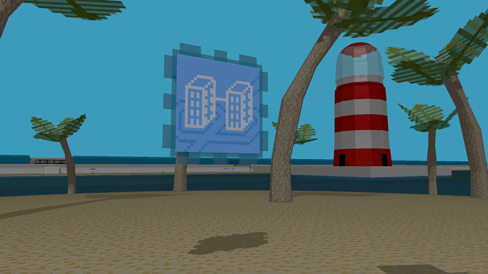
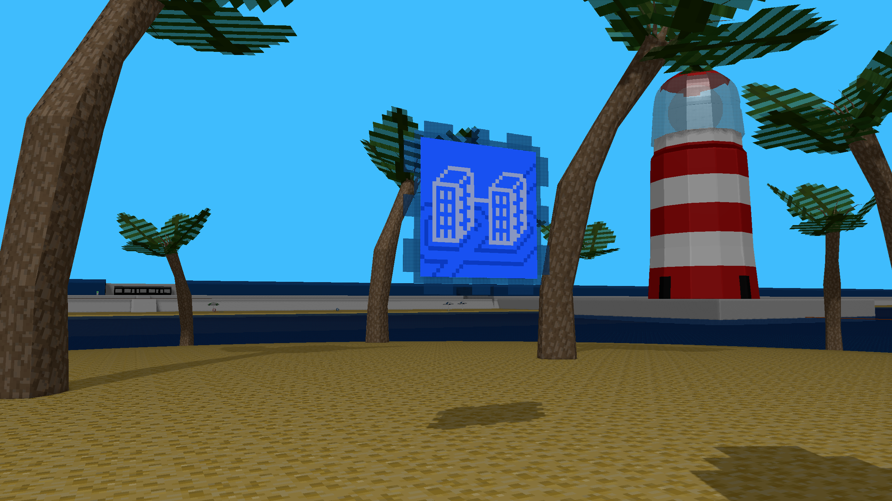
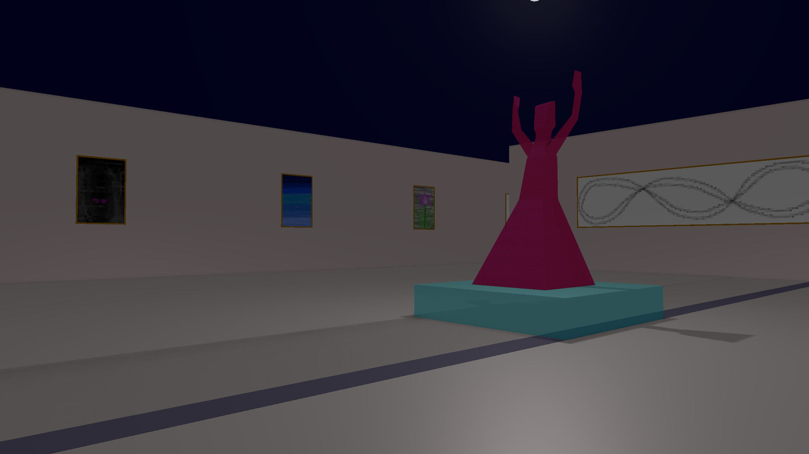
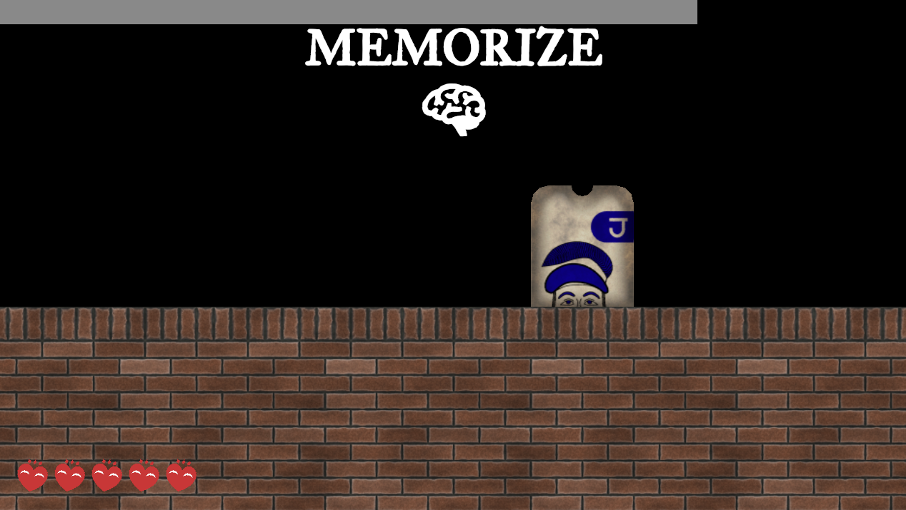
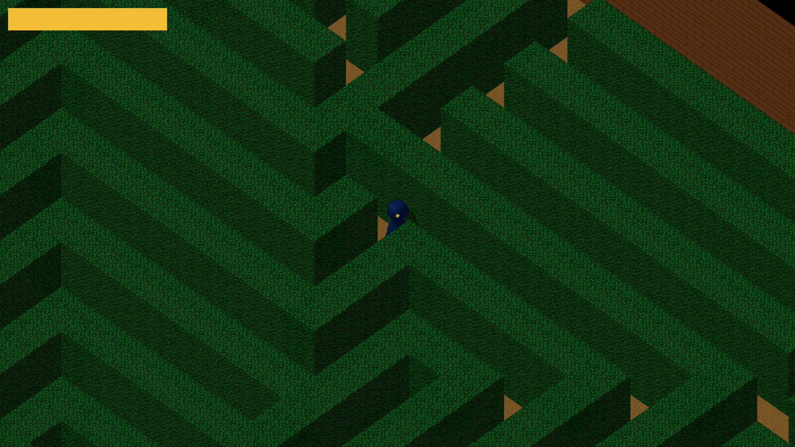

# NutshellEngine's 4th anniversary!

One month ago and a few days was NutshellEngine's 4th anniversary. This article is (very) late as I was busy wrapping up [Manorbound](https://store.steampowered.com/app/5175950/Manorbound/)'s development.

## What happened this year
This year, NutshellEngine got [**10 releases**](https://team-nutshell.itch.io/nutshellengine/devlog) (0.2.1 - 0.3.3).

Some of the big things that were added or modified:
- **Reversed Depth**: The graphics module included with the editor and the editor's renderer now use reversed depth so that objects that are really far and pretty close to each other won't Z-fight anymore. The results have been extremely positive.

- **Command line** is now usable. The engine automatically parses it and gives a map with each command and its parameters that Scripts can read.

- **Animation rework**: The animations were pretty wonky, now they work. Animations are now referred by name instead of an index inside the model's data, so that different entities can use the same animation from the same file.

- **Editor improvements**: Many UI/UX improvements and the renderer is now closer to the runtime's renderer, including shadowmaps and the addition of frustum culling to improve its performance.

- **Many reworks**: Asset management in general, textures, colliders, Scripts manager, etc. Many systems have been reworked to improve either their usability, robustness, or both.

## Long lasting bugs were fixed
**Colors were wrong** this whole time because the diffuse textures of the materials were not loaded in the sRGB colorspace. It's now fixed.

*Top: before - Bottom: after, screenshot from a previous version of B-Line*

**Particles colors were also wrong**, they are now right.

## Released games
During this year, **three games** have been made with NutshellEngine, with 2 of them being released on Steam!

All these games have been made by me, the one made during Global Game Jam was also made with a friend.

[**B-Line**](https://store.steampowered.com/app/3939010/BLine/) has been released on **Steam** in October 2025. It's a walking simulator knowledge-based game where you explore subway stations to find how to escape. It is the first game made with NutshellEngine to be published on Steam.

[**Chromatichaos Inc.**](https://ntsh-oni.itch.io/chromatichaos-inc) has been made with a friend **during a weekend** for Global Game Jam 2026 with the theme **Mask** and is a Wario-Ware like where you use masks of color at the right time to win some mini-games.

The last one has technically been released after the 4th anniversary but is the reason why this article is very late so here it is.

[**Manorbound**](https://store.steampowered.com/app/5175950/Manorbound/) has been released on **Steam** in October 2026. It's an adventure exploration puzzle game set in a manor trapped in a time loop. Explore a manor and discover its secrets while it is collapsing under the sand.

## Conclusion
Releasing games on Steam was a really nice experience, and even though I can't be completely focused on improving the engine anymore during these games' production times, working on them forced me to also improve many of the engine's systems, and I think that many of these changes, and editor's UI/UX improvements, wouldn't have happened if I didn't work on big game projects with the engine.

[Back to NutshellEngine index](../index.md)